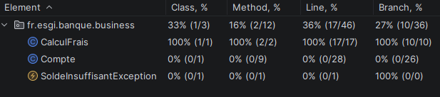
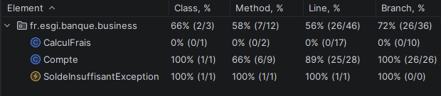

CRANCHI BELLONE Théodore
ESGI Reims

# Problèmes rencontrés :
- C5 : Débiter n'acceptait pas qu'on atteigne excatement le découvert autorisé.
- C6 : estVide n'acceptait pas des écritures diféérente de zéro.
- F3 : Les jeunes de 26 ans ne devrait pas avoir de réduction.
- F4 : Avoir exactement 1000 euro ne devrait pas offir les frais.
- F5 : La condition de la carte premium devait etre en premier dans la logique métier.

# Partie B
- J'ai seulement réussi à faire le red de la première règle.

